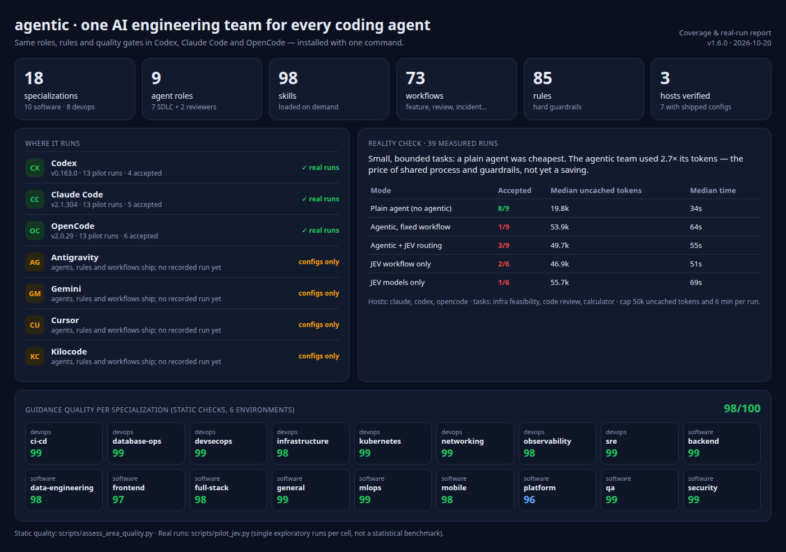
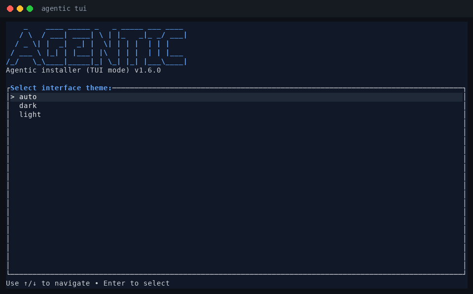

# Agent Intelligence Configuration (agentic)

> **18 areas · 10 Software specs · 8 DevOps specs · 7 SDLC agents + 2 specialists · 105+ skills · 73+ workflows**

A unified catalog of agentic specializations and the `agentic` CLI. Install orchestrator-ready rules, skills, workflows,
and prompts into any project — and run a full SDLC agent team out of the box.

- [Website](https://sawrus.github.io/agent-guides/)
- [Coverage scorecard](https://claude.ai/public/artifacts/8177bc3d-3b2f-48a6-8232-47c5b02b20f3)
- [CLI usage guide](docs/agentic-usage.md)
- [JEV native hooks and real CLI testing](docs/jev-integration/README.md)
- [Claude Code integration](docs/claude-code/README.md)
- [Telegram notifications](docs/notifications/README.md)
- [JEV research and opt-in CLI prototype](docs/jev-rnd/README.md)
- [Releases (prebuilt binaries)](https://github.com/sawrus/agent-guides/releases)
- [NPM package](https://www.npmjs.com/package/@jetrabbits/agentic)

## Coverage snapshot



Coverage report for the current catalog across areas, specs, skills, and workflows.

---

## Why agent-guides is different

Most agent prompt libraries give you a smarter *single agent*. agent-guides gives you a **coordinated team**:

```
@product-owner → @team-lead → @developer → @qa → (@devops-engineer) → post-task review
```

`@pm` (delivery planning) and `@analyst` (system analysis) join when the change needs them; `@devops-engineer` is an
optional stage before the read-only post-task review by `@instruction-reviewer` and `@memory-curator`.

Each role has hard boundaries, explicit handoff criteria, and measurable success metrics. The Product Owner orchestrates
the full SDLC; no other agent library ships this out of the box.

Works with **Claude Code**, **opencode**, **Cursor**, **Codex**, **kilocode**, **antigravity** and **Gemini**.

---

## What this is

agent-guides is a structured knowledge base for AI coding agents. Instead of writing long system prompts, you install
focused, composable guidance files that agents load on demand based on the task at hand.

Each **area** (e.g., `devops/kubernetes`) provides:

| File type           | Purpose                                   | When loaded                        |
|:--------------------|:------------------------------------------|:-----------------------------------|
| `AGENTS.md`         | Navigation index, load order, constraints | First — always                     |
| `rules/*.md`        | Hard constraints the agent must follow    | Always, for the active spec        |
| `skills/*/SKILL.md` | Technical capabilities and patterns       | On demand, matching "When to load" |
| `workflows/*.md`    | Orchestrated step-by-step processes       | On `/command` trigger              |
| `prompts/*.md`      | Human copy-paste templates (EN + RU)      | Reference / paste                  |

---

## Repository structure

```text
agent-guides/
├── areas/
│   ├── software/              # Application development
│   │   ├── general/           # Shared baseline — all software specs inherit from here
│   │   ├── backend/           # REST/GraphQL APIs, services, database access
│   │   ├── frontend/          # Components, accessibility, performance, CSS
│   │   ├── full-stack/        # End-to-end product features
│   │   ├── data-engineering/  # dbt, warehouses, pipelines, streaming
│   │   ├── mlops/             # Training, evaluation, serving, monitoring
│   │   ├── mobile/            # iOS, Android, React Native, Flutter
│   │   ├── platform/          # K8s manifests, IaC, CI/CD, secrets
│   │   ├── qa/                # Test strategy, coverage, flakiness, performance
│   │   └── security/          # Threat modeling, SAST/DAST, auth, compliance
│   └── devops/                # Platform and operations
│       ├── kubernetes/        # Cluster bootstrap, workload ops, RBAC, upgrades
│       ├── ci-cd/             # GitHub Actions, GitLab CI, quality gates, supply chain
│       ├── infrastructure/    # Terraform, Ansible, IaC standards, drift detection
│       ├── observability/     # Prometheus, Loki, Tempo, Grafana, SLOs
│       ├── sre/               # SLOs, error budgets, incidents, chaos engineering
│       ├── networking/        # Ingress, TLS, service mesh, DNS, VPC
│       ├── devsecops/         # Shift-left, SBOM, OPA/Kyverno, container hardening
│       └── database-ops/      # PostgreSQL, Redis, migrations, backup/restore
├── extensions/
│   ├── opencode/              # OpenCode agent definitions, commands, skills
│   │   └── agents/            # SDLC agents + post-task specialists for .opencode/agents/
│   ├── claude/                # Claude Code configs
│   │   └── agents/            # SDLC agents + post-task specialists for .claude/agents/
│   ├── antigravity/           # Antigravity platform configs
│   ├── codex/                 # Codex custom agents and override configs
│   │   └── agents/            # SDLC agents + post-task specialists for .codex/agents/
│   └── gemini/                # Gemini-specific configs
│   │   └── agents/            # SDLC agents + post-task specialists for .gemini/agents/
├── areas/template/            # Authoring templates — start here for new content
├── docs/                      # Setup and usage guides
├── AGENTS.md                  # Root agent guidance (loaded into every project)
└── src/                       # Rust CLI installer (self-contained binary)
```

---

## Quick start

### Requirements

`agentic` is a single self-contained binary — no runtime dependencies. The
knowledge base (areas, extensions) is embedded into the binary.

- required: nothing (the binary works standalone)
- optional: `python3` + `pip` (only for the MemPalace integration), agent
  binaries such as `codex`, `opencode`, `claude`, `gemini` (for doctor smoke
  checks and actual agent work)

### Install

Via npm (thin launcher that fetches the platform binary on first run):

```bash
npx @jetrabbits/agentic@latest
```

Or bootstrap the latest release binary (linux x86_64/aarch64, macOS Intel/ARM):

```bash
curl -fsSL https://raw.githubusercontent.com/sawrus/agent-guides/main/install | bash
```

Or download a binary for your platform from
[GitHub Releases](https://github.com/sawrus/agent-guides/releases) and run:

```bash
./agentic self-install --force
```

Build from source (Rust toolchain required):

```bash
make release-build && make install
```

### Run

```bash
agentic
```

### Upgrade

```bash
agentic upgrade
agentic upgrade --project-dir /path/to/project
agentic upgrade --force --dry-run
agentic upgrade --force
```

`upgrade` downloads the newest release binary from GitHub Releases and
atomically replaces the installed one, then synchronizes project instructions using
the new executable. Recognizable legacy artifacts are adopted; non-overlapping
local edits are merged. Conflicts are replaced after backup, and fully user-owned
instructions are preserved. `--force` rebuilds Agentic artifacts without prompts,
using manifest settings or `default + software.general` when settings are unavailable.
Unrelated project files and global configuration are preserved. Backups live in
`.agentic-backups/` and may contain credentials; exclude them from source control.
See [smart upgrade behavior](docs/agentic-upgrade/README.md) for details.

### Full instructions

- [CLI usage guide](docs/agentic-usage.md)
- [Installed CLI lifecycle](docs/agentic-lifecycle.md)

## See agentic in action



Interactive walkthrough of the `agentic` CLI flow: choose a target project, pick agent platforms, and install the
guidance bundle.

---

## SDLC Agent team

The same 7-agent SDLC team works across **Claude Code**, **OpenCode**, **Codex**, and any tool that supports agent or
subagent files. Agentic also ships post-task review specialists for instruction quality and docs/memory hygiene, automatic for hooked workflows and optional elsewhere.

| Agent             | Role                                           | Invoke when                                   |
|:------------------|:-----------------------------------------------|:----------------------------------------------|
| `product-owner`   | Scope, acceptance criteria, SDLC orchestration | Start of any feature; final acceptance        |
| `pm`              | Planning, milestones, risk register            | Scope is defined, execution needs tracking    |
| `team-lead`       | Architecture, code review, quality gates       | Planning and pre-release sign-off             |
| `developer`       | Implementation, tests, delivery                | Implementation plan is approved               |
| `qa`              | Verification, defect classification, go/no-go  | Developer hands off an increment              |
| `analyst`         | Requirements, scenarios, API/data contracts, UX states | Planning; requirement and contract review |
| `devops-engineer` | CI/CD, IaC, platform reliability               | Anything touching infra, pipelines, or deploy |

Each agent has an `Identity`, `Communication Style`, `Success Metrics`, and explicit `Boundaries` (OpenCode agents also
carry a one-line `vibe`), so roles never overlap and handoffs are always documented. In Claude Code the
`product-owner` runs as the main session because subagents cannot start other subagents.

Post-task specialists run outside the mandatory SDLC role matrix. The six delivery workflows listed in the [Review Pipeline](docs/review-pipeline.md) invoke both automatically after successful top-level delivery:

| Agent                  | Role                                             | Invoke when                                      |
|:-----------------------|:-------------------------------------------------|:-------------------------------------------------|
| `instruction-reviewer` | Post-task instruction effectiveness review       | Successful delivery workflow with a review hook |
| `memory-curator`       | Post-task docs and memory hygiene recommendations         | Successful delivery workflow with a review hook      |

See [Review Pipeline](docs/review-pipeline.md) for the guidance-mode pipeline and `.reviews/<task-id>/` output
convention. The installed [REVIEW_PIPELINE.md](REVIEW_PIPELINE.md) is loaded only at review time. Reports are compact, evidence-backed, and advisory; no instructions, docs, or memory are changed automatically.

| Platform    | Agent path                      | Format                         | Guide                                                                                           |
|:------------|:--------------------------------|:-------------------------------|:------------------------------------------------------------------------------------------------|
| Claude Code | `project/.claude/agents/*.md`   | Markdown with YAML frontmatter | [Claude Code subagents](https://docs.claude.com/en/docs/claude-code/sub-agents) · [setup](docs/claude-code/README.md) |
| OpenCode    | `project/.opencode/agents/*.md` | Markdown with frontmatter      | [OpenCode agents](https://opencode.ai/docs/agents/) · [repo setup note](docs/opencode_setup.md) |
| Codex       | `project/.codex/agents/*.toml`  | TOML custom agents             | [Codex subagents](https://developers.openai.com/codex/subagents)                                |
| Gemini      | `project/.gemini/agents/*.md`   | Markdown with YAML frontmatter | [Gemini subagents](https://geminicli.com/docs/core/subagents)                                   |

---

## JEV: native decision hooks

[JEV](docs/jev-integration/README.md) is an optional, paid decision service (TypeSafe AI) that runs inside each
host's native hooks. It does not add an MCP server or a workflow runner.

- **Workflow selection.** On the first prompt it picks one of the installed `.agent/workflows/*.md` (options use each
  workflow's `selection.use-when`), or `native` / `clarify`, and tells the host to execute the workflow as the declared
  initiator.
- **Model routing.** Before a subagent starts, it picks the cheapest sufficient tier (`fast` / `balanced` /
  `frontier`). The hook maps the tier to a model: Claude `haiku`/`sonnet`/`opus`, Codex
  `extensions/codex/model-tiers.json`, OpenCode by catalog price, or by the shipped tier map
  `extensions/opencode/model-tiers.json` when the catalog has no usable prices. Without a confident answer the role
  default applies; on OpenCode it falls back to the role's tier model, so a default install also routes. Explicit
  pins are preserved.
- **Permission decisions.** allow / deny / ask from path and command metadata (never file content), with automatic
  approval limited to bounded project paths.
- **Review packet.** A task-scoped `.agentic/jev/review-*.json` packet goes to `instruction-reviewer`.
- **Safety and audit.** Errors, timeouts (8 s) and confidence below the per-question threshold
  (`settings.jev.thresholds`, default 0.9) keep the native behavior. Cleansed audit records with `decision`,
  `outcome` and `model_source` are kept 30 days in `.agentic/jev/`.

```sh
agentic install --project-dir <dir> --agent-os claude,codex,opencode --areas software \
  --specializations software.backend,software.general --enable-jev   # TYPESAFE_API_KEY or JEV_API_KEY in env/.env
make blackbox-claude   # paid real-CLI check; also blackbox-codex, blackbox-opencode, blackbox (all)
```

---

## Feature support by platform

✅ supported **and verified in a real CLI blackbox run** · ☑️ supported, covered by offline tests only · ➖ not supported

| Feature | OpenCode | Codex | Claude Code | Gemini | Cursor · Kilocode · Antigravity |
|:--|:-:|:-:|:-:|:-:|:-:|
| SDLC role subagents (9 roles incl. `analyst`, reviewers) | ✅ | ✅ | ✅ | ☑️ | ➖ |
| Rules (auto-loaded) | ☑️ | ☑️ ¹ | ✅ | ☑️ ¹ | ☑️ |
| Skills | ☑️ | ☑️ ¹ | ✅ | ☑️ ¹ | ☑️ |
| Workflows as commands | ✅ | ✅ ¹ | ✅ | ☑️ ¹ | ☑️ ¹ |
| MCP servers (Context7, MemPalace, Playwright, …) | ☑️ | ☑️ | ☑️ | ☑️ | ☑️ (Cursor, Kilocode) |
| Memory guidance (`MEMORY.md`, MemPalace) | ☑️ | ☑️ | ✅ | ☑️ | ☑️ |
| Post-task review (`instruction-reviewer` + `memory-curator`) | ✅ | ✅ | ✅ | ☑️ | ➖ |
| Model profiles per role | ☑️ (openai, githubcopilot, user) | ☑️ (TOML defaults) | ☑️ (`anthropic`) | ➖ | ➖ |
| Telegram: task finished | ✅ (plugin) ² | ✅ (hooks) | ✅ (hooks) | ➖ | ➖ |
| Telegram: waiting for input | ✅ (plugin) ² | ☑️ (hooks) ² | ☑️ (hooks) ² | ➖ | ➖ |
| **JEV** · workflow selection | ✅ | ✅ | ✅ | ➖ | ➖ |
| **JEV** · subagent model routing | ✅ | ✅ | ✅ | ➖ | ➖ |
| **JEV** · permission decisions | ☑️ | ☑️ | ☑️ | ➖ | ➖ |
| **JEV** · reviewer evidence packet | ☑️ | ✅ | ✅ | ➖ | ➖ |
| Real-CLI blackbox target | `make blackbox-opencode` | `make blackbox-codex` | `make blackbox-claude` | ➖ | ➖ |

¹ Through the shared `.agent/` directory that `AGENTS.md` tells the agent to read, not a native discovery path.
² Real CLI, real Telegram bot, outside the blackbox target (2026-10-16). OpenCode V2 delivered both events;
the Claude/Codex waiting messages were sent through the same script with recorded hook payloads.

Real runs:

- **Claude Code 2.1.301, Agentic 1.4.0, 2026-10-16:** all ten checks passed (`.agentic-blackbox/20261016-165654`).
  JEV permission evaluations fell back below confidence 0.9 in that run.
- **Claude Code 2.1.302, Agentic 1.4.0, 2026-10-17, `opus` session:** all ten checks passed (`.agentic-blackbox/20261017-232709`)
  after the hand-back and profile-fallback fixes. JEV routed exploration to `haiku`; the other spawns fell back to
  the Claude profile role models (`developer`/`qa` → `sonnet`, `team-lead` → `opus`, reviewers → `haiku`) instead of
  inheriting `opus`. See [verification](docs/jev-integration/verification.md).
- **OpenCode 2.0.29 (`openai/gpt-6-luna`), Agentic 1.4.0, 2026-10-16** (`.agentic-blackbox/20261016-233233`): JEV
  selected the workflow, and the agent ran PO → `pm` → `team-lead` → `developer` → `qa` → `instruction-reviewer` +
  `memory-curator` with the new role names. An independent probe verified the calculator. JEV answered `no_decision`
  for all ten spawns, so subagent model routing was not re-confirmed (it was in the 1.3.0 run).
- **Codex 0.163.0, Agentic 1.4.0, 2026-10-17** (`.agentic-blackbox/20261016-232317`): all six checks passed. JEV selected
  the workflow and applied `gpt-6-luna` to 8 of 9 spawns (PO, `pm`, `team-lead`, `developer`, `qa`, both reviewers);
  the calculator was verified independently, and the Telegram `Stop` hook delivered. The run used
  `BLACKBOX_CODEX_SANDBOX=danger-full-access`, because this host (`kernel.apparmor_restrict_unprivileged_userns=1`)
  blocks the bubblewrap `workspace-write` sandbox.
- **Codex 0.161.0 and OpenCode V2, Agentic 1.3.0, 2026-10-14:** model routing and calculator checks passed.

Details: [JEV verification](docs/jev-integration/verification.md).

---

## What gets installed where

`agentic` installs shared guidance into `.agent/` and selected IDE files into directories like `.claude/`,
`.opencode/`, and `.codex/`. Generated runtime guidance goes to `AGENTS.md`; OpenCode also gets `.opencode/AGENTS.md`.

```text
project/.agent/
├── rules/       ← constraints active for every task in this project
├── skills/      ← capabilities loaded on demand
├── workflows/   ← processes triggered by slash commands
└── prompts/     ← human-paste templates

project/.claude/                 ← with --agent-os claude
├── CLAUDE.md    ← @AGENTS.md / @MEMORY.md imports
├── agents/      ← 9 role subagents (tools + model per profile)
├── rules/       ← auto-loaded rules
├── skills/      ← native skills
├── commands/    ← one /<workflow> wrapper per .agent/workflows/*.md
└── settings.json← agent: product-owner, MCP approvals, JEV/Telegram hooks (ownership-tracked)
```

---

## Agent IDE options (interactive install)

### MCP

- `opencode-docs` (safe): adds OpenCode documentation through a local MCP server.
- `playwright` (sensitive): adds browser automation through Playwright MCP.
- `kubernetes` (dangerous): adds Kubernetes cluster access through Kubernetes MCP.
- `youtube-transcript` (safe): adds YouTube transcript lookup through a local MCP server.
- `docker-mcp` (dangerous): adds Docker MCP Gateway as the generated `docker` MCP server.
- `context7` (safe): adds a remote MCP server for up-to-date framework, library, SDK, and API documentation.
- `mempalace` (sensitive): adds a local memory MCP server for project context discovery and reuse.
- `anydb` (dangerous): adds database access through AnyDB MCP.

### Telegram notifications (OpenCode, Claude Code, Codex)

- Every host sends through the shared `.agent/notify/telegram.py`: OpenCode through its V2 plugin, Claude Code and
  Codex through native hooks. Messages arrive when the agent finishes and when it waits for input (permission or
  question).
- Agent Markdown is rendered as Telegram formatting: bold, code, links, lists, tables as monospace blocks. Long answers
  arrive as a `.md` attachment with a preview.
- Enable with `--enable-telegram` or the interactive prompt; credentials stay in `~/.config/agentic/config.json`.
  See [Telegram notifications](docs/notifications/README.md).

### OpenCode Plugins

- `Agent Model Mapping`: maps `.opencode/agents/*.md` roles to main and fallback OpenCode models during interactive
  `agentic install`/`agentic tui`. Stored internally as `agent-model-mapper`; OpenCode startup never prompts or writes
  project files.

### OpenCode Model Profiles

- `OpenAI Model Profile`: applies the bundled OpenAI model mapping from `extensions/opencode/profiles/openai/`.
- `GitHub Copilot Model Profile`: applies the bundled GitHub Copilot model mapping from
  `extensions/opencode/profiles/githubcopilot/`.
- User profiles: place `opencode.json` files under `$HOME/.config/agentic/opencode/profiles/<profile-id>/`. For
  example, `$HOME/.config/agentic/opencode/profiles/DT/opencode.json` appears in the optional OpenCode plugin menu as
  `DT profile`, and `$HOME/.config/agentic/opencode/profiles/GH/opencode.json` appears as `GH profile`.
- `none`: applies no model profile and does not copy the baseline `extensions/opencode/opencode.json` just for profile
  selection. OpenCode MCPs, Telegram notifications, and model mapping may still create or update `.opencode/opencode.json`
  when those options are selected.

### Claude Code Model Profiles

- `anthropic` (default): `opus` for product-owner and team-lead, `sonnet` for developer, qa, devops-engineer and
  analyst, `haiku` for pm and both reviewers. Written as `model:` in `.claude/agents/*.md`.
- `none` (`--claude-profile none`): every role inherits the session model.
- With JEV enabled, models stay open so JEV hooks route each Agent call to an alias.

---

## Contributing

See [CONTRIBUTING.md](CONTRIBUTING.md) for authoring standards, templates, and the pull request process.

Quick checklist before opening a PR:

- [ ] Used the appropriate template from `areas/template/`.
- [ ] No `{{PLACEHOLDER}}` values remain.
- [ ] Spec map in `AGENTS.md` updated.
- [ ] Constraints in rules use imperative language.
- [ ] Prompt examples include both EN and RU blocks.

---

## License

See [LICENSE](LICENSE) if present, or contact the maintainers.
