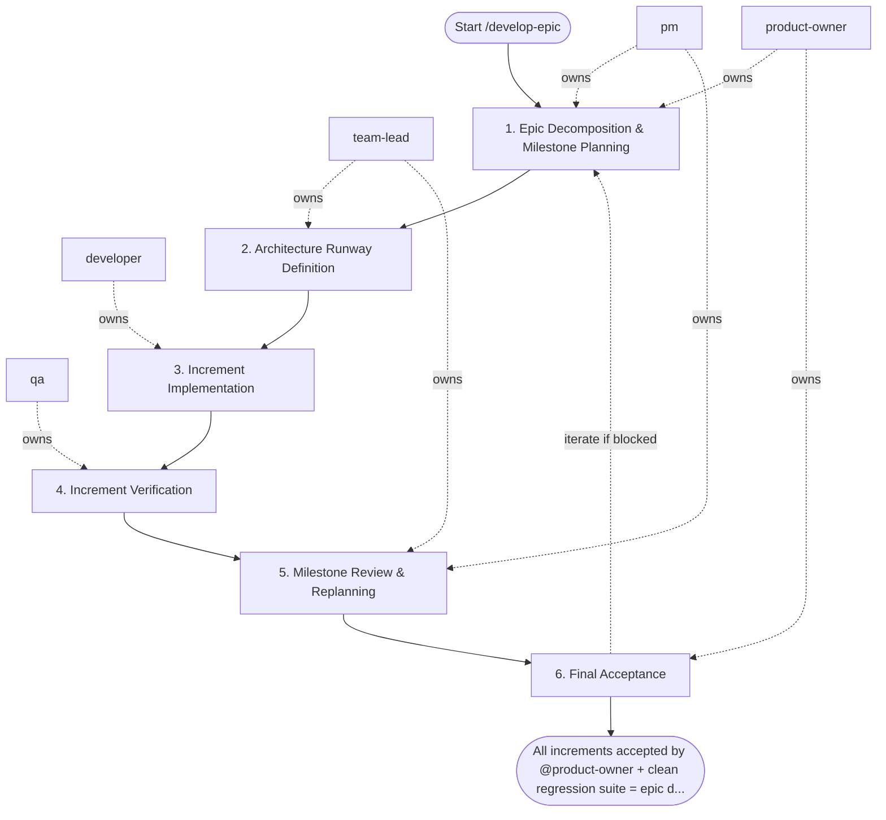

## Steps

### 1. Epic Decomposition & Milestone Planning — `@product-owner` + `@pm`
- **Input:** epic goals and high-level backlog
- **Actions:** decompose epic into independently deliverable increments (max 1–2 weeks each); define milestone acceptance criteria; prioritize increments by value and risk; identify inter-increment dependencies
- **Output:** `docs/<epic>/epic_plan.md` — increment list, acceptance criteria per increment, dependency map
- **Done when:** `@product-owner` approves scope; `@pm` has a delivery sequence

### 2. Architecture Runway Definition — `@team-lead`
- **Input:** epic plan
- **Actions:** identify shared infrastructure needed across increments (DB schema, shared services, API contracts); design the architecture runway — foundational work that must precede feature increments; document module layout and inter-service contracts; flag risks and non-functional requirements (performance, security, scalability)
- **Output:** `docs/<epic>/architecture_notes.md` — layering decisions, migration plan, risk register
- **Done when:** architecture runway approved; `@developer` can start Increment 1

### 3. Increment Implementation — `@developer`
- **Input:** increment spec from epic plan + architecture notes
- **Actions:** implement current increment per `/develop-feature` workflow (Steps 3–6 of that workflow); each increment must have its own branch, tests, and acceptance evidence; do not start next increment without current one passing verification
- **Output:** implemented increment on branch with passing checks
- **Done when:** increment passes local checks and is ready for QA

### 4. Increment Verification — `@qa`
- **Input:** implemented increment
- **Actions:** verify acceptance criteria for the current increment; run regression tests against all previously merged increments; document any cross-increment integration issues
- **Output:** increment test report; integration risk notes if any
- **Done when:** increment accepted; no regressions introduced

### 5. Milestone Review & Replanning — `@pm` + `@team-lead`
- **Input:** completed increment(s) + integration risk notes
- **Actions:** review progress against epic plan; replan remaining increments based on learnings; update risk register; communicate status to `@product-owner`; adjust scope if needed (add/drop items with `@product-owner` approval)
- **Output:** updated `epic_plan.md`; `risk_register.md` updated; stakeholders informed
- **Done when:** next increment is prioritized and `@developer` is briefed

### 6. Final Acceptance — `@product-owner`
- **Input:** all increments delivered + complete risk summary
- **Actions:** validate all epic acceptance criteria are met; review risk register for residual items; make go/defer decision on any remaining scope; update epic docs under `docs/**`, add a `CHANGELOG.md` entry, and bump the project version
- **Output:** `docs/<epic>/delivery_summary.md` — accepted items, deferred items, follow-up backlog
- **Done when:** epic accepted; follow-up items logged; docs, `CHANGELOG.md`, and version bump committed

## Agent Interaction Diagram

<!-- agent-diagram:start -->

<!-- agent-diagram:end -->

## Iteration Loop
Steps 3–5 repeat for each increment (bounded by the increment count from the epic plan in step 1; if a single increment fails review 3 times, escalate to `@team-lead`). Replanning in Step 5 governs scope adjustments.

## Optional JEV skill

Read `settings.jev.enabled` in project `.agentic.json`. When true, load
`.agent/skills/jev/SKILL.md` and use its helper at the checkpoints below.
When false/absent, skip this section and execute the standard workflow.
JEV is advisory; all required roles, QA, architecture sign-off and acceptance
remain mandatory. Missing/uncertain answers return to the assigned role. Copy
the question objects from the skill’s `references/questions.json` and follow
its `references/checkpoints.md` packet/action contracts; do not improvise
weaker questions. Keep original request and agreed scope in every packet.

| Checkpoint | State and maintained question | Handling |
| --- | --- | --- |
| Before approving a plan or extending scope | Original request, agreed scope/non-goals, approval provenance and proposed work. Use `scope_alignment` when scope alignment is disputed. | `scope_change` sends additions separately to PO/stakeholder; `clarify` gathers the missing decision. No silent maintenance or new resources. Normal plan approval remains mandatory. |
| Before the first spawn of each role, including exploration and specialists | Separate scoped role task and available model capabilities/cost order. Use `routing`: “Choose the least expensive sufficient model tier for this role's exact task within the original request and agreed scope.” | Apply a confident supported model override, preserving user pins/permissions. Record requested/observed model and fallback. Existing agents keep their model on followups; unsupported hosts retain their configured model. |
| Developer verification handoff | One claim, independent current command/run/tree identity, scenario/assertion and results. Use `evidence_support` for semantic coverage after local checks. | `supported` hands evidence to QA; `contradicted` returns a concrete finding; `insufficient` asks QA for the missing scenario/assertion. Failed/stale/missing command evidence needs no API call. JEV cannot authenticate execution. |
| Disputed review finding | Finding ID, cited criterion/gate, impact and diff evidence. Use `review_blocker`. | TL retains severity/sign-off ownership; optional unrelated maintenance becomes a separate proposal. Known failed gates already block without JEV. |
| After fixes, before another loop | Blocker IDs, current diff, independently verified closures, attempt history, limit and new hypothesis. Use `loop_action`. | `continue` gives Developer a bounded new hypothesis and QA retest; `gather_evidence` requests reproduction; `replan` requires PO/TL approval; `escalate` sends history to owners. `complete` requires all existing gates; exhausted limits escalate locally. |
| Before final acceptance | Exact criterion plus independent QA scenarios/assertions, expected/actual outputs and tree identity. Use `acceptance_support` per criterion. | PO owns acceptance. Contradictions return to QA/Developer; insufficient proof requests the missing scenario. Batch independent criteria; never weaken a criterion to match implemented behavior. |
| After the successful post-task specialist pair | Observed run history, current docs/instructions and concrete proposals with id/source/target/owner/done_when. Use `process_effectiveness`, `review_action` and independent `followup_needed` per proposal. | Report effectiveness separately from selected next-task IDs. Explicitly state no followup or missing evidence. Include target/owner/done_when for each recommendation; do not auto-edit guidance/memory. Cost efficiency uses `cost_effectiveness` only with measured total costs and a comparable accepted baseline; otherwise record insufficient locally. |

Invoke once for unchanged checkpoint evidence; batch related atomic questions.
Treat Choice/Score confidence below the skill's advisory floor as uncertain.
Never rerun merely to obtain a favorable verdict. No JEV request occurs when
its flag is disabled or there is no semantic decision beyond a deterministic check.

**JEV increment prioritization**

After decomposition and milestone replanning, validate dependencies locally
and form the feasible shortlist. Preserve stakeholder priority pins. Each
candidate packet names the increment, agreed scope, sourced value/urgency/risk
facts and agreed effort. Missing factors go to PO/PM, never become zero.
Use separate `priority_value`, `priority_urgency`, `priority_risk` Score
questions from the shared templates. Keep deadlines, dependency checks,
agreed weights/effort arithmetic, ranking and tie handling local. Uncertain
scores retain the existing plan. PO/PM approve the next ready increment;
JEV cannot put it ahead of prerequisites or change the approved scope.

## Post-task review

- **Coordinator:** `@product-owner` (`execution.initiator`).
- **When:** after successful acceptance/sign-off and docs, CHANGELOG, and version completion, before the final user response.
- **Actions:** load `REVIEW_PIPELINE.md` from the project root; hand the same bounded evidence packet to `instruction_reviewer` and `memory_curator` as read-only specialists outside SDLC `roles`.
- **Once only:** review the top-level task once; nested workflows/increments hand observations to the parent. Do not launch inside fix/retest loops or after failed/deferred delivery.
- **Output:** `.reviews/<task-id>/instruction-review.md`, `memory-curation.md`, and `summary.md` (timestamp fallback per protocol); link them in the final response.
- **Failure:** record unavailable/failed specialists and evidence limitations; do not block successful delivery or retry automatically. Recommendations only; apply changes in a separate requested task.

## Exit
All increments accepted by `@product-owner` + clean regression suite = epic delivered.

**Next:** terminal — no follow-up workflow.
