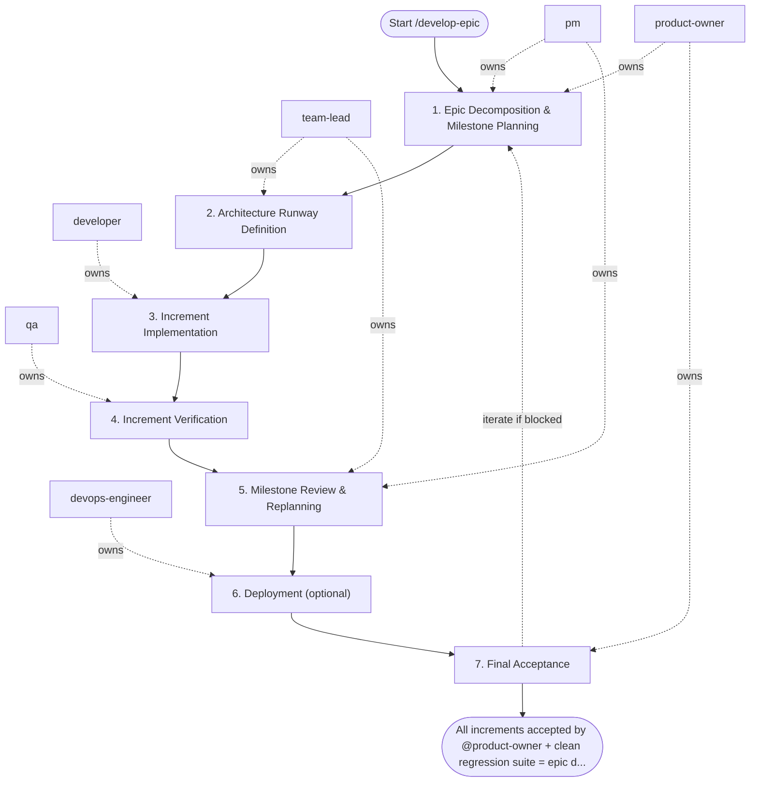

## Steps

### 1. Epic Decomposition & Milestone Planning — `@product-owner` + `@pm`
- **Input:** epic goals and high-level backlog
- **Actions:** decompose epic into independently deliverable increments (max 1–2 weeks each); define milestone acceptance criteria; prioritize increments by value and risk; identify inter-increment dependencies
- **Output:** `docs/<epic>/epic_plan.md` — increment list, acceptance criteria per increment, dependency map
- **Done when:** `@product-owner` approves scope; `@pm` has a delivery sequence

### 2. Architecture Runway Definition — `@team-lead`
- **Input:** epic plan
- **Actions:** identify shared infrastructure needed across increments (DB schema, shared services, API contracts); design the architecture runway — foundational work that must precede feature increments; document module layout and inter-service contracts; flag risks and non-functional requirements (performance, security, scalability)
- **Output:** `docs/<epic>/architecture_notes.md` — layering decisions, migration plan, risk register
- **Done when:** architecture runway approved; `@developer` can start Increment 1

### 3. Increment Implementation — `@developer`
- **Input:** increment spec from epic plan + architecture notes
- **Actions:** implement current increment per `/develop-feature` workflow (Steps 3–6 of that workflow); each increment must have its own branch, tests, and acceptance evidence; do not start next increment without current one passing verification
- **Output:** implemented increment on branch with passing checks
- **Done when:** increment passes local checks and is ready for QA

### 4. Increment Verification — `@qa`
- **Input:** implemented increment
- **Actions:** verify acceptance criteria for the current increment; run regression tests against all previously merged increments; document any cross-increment integration issues
- **Output:** increment test report; integration risk notes if any
- **Done when:** increment accepted; no regressions introduced

### 5. Milestone Review & Replanning — `@pm` + `@team-lead`
- **Input:** completed increment(s) + integration risk notes
- **Actions:** review progress against epic plan; replan remaining increments based on learnings; update risk register; communicate status to `@product-owner`; adjust scope if needed (add/drop items with `@product-owner` approval)
- **Output:** updated `epic_plan.md`; `risk_register.md` updated; stakeholders informed
- **Done when:** next increment is prioritized and `@developer` is briefed

### 6. Deployment (optional) — `@devops-engineer`
- **Input:** QA go recommendation and the infrastructure, pipeline, configuration, or rollout changes the increment needs
- **Actions:** skip with a one-line note when no CI/CD, infrastructure, or deployment change is needed; otherwise apply changes through code (IaC / pipeline definitions), run the pipeline, and verify the rollback path; run once per deployable increment when the epic ships incrementally
- **Output:** pipeline run evidence and `ops_notes.md` (or the documented skip)
- **Done when:** deployment evidence is attached, or the step is explicitly skipped as not needed

### 7. Final Acceptance — `@product-owner`
- **Input:** all increments delivered + complete risk summary
- **Actions:** validate all epic acceptance criteria are met; review risk register for residual items; make go/defer decision on any remaining scope; update epic docs under `docs/**`, add a `CHANGELOG.md` entry, and bump the project version
- **Output:** `docs/<epic>/delivery_summary.md` — accepted items, deferred items, follow-up backlog
- **Done when:** epic accepted; follow-up items logged; docs, `CHANGELOG.md`, and version bump committed

## Agent Interaction Diagram

<!-- agent-diagram:start -->

<!-- agent-diagram:end -->

## Iteration Loop
Steps 3–5 repeat for each increment (bounded by the increment count from the epic plan in step 1; if a single increment fails review 3 times, escalate to `@team-lead`). Replanning in Step 5 governs scope adjustments.

## Codex assignment preparation

When JEV is enabled and the installed runtime offers `--prepare-spawn`, the coordinator sends the exact goal, scope and complexity plus current session/task IDs and a unique request ID to that local interface before native spawning. Copy the returned `spawn` object unchanged with the complete assignment; this is an explicit prepared selection, not a guessed override. Its `agent_type` selects the canonical role profile, so user pins and native profile policy win. If the hook denies the launch, use native role defaults once, do not retry, and report `recommendation_discarded` with its reason code; report missing correlation as unconfirmed. Never invent spawn arguments, decrypt transport data, or change sandbox/approval policy. Without actionable metadata, keep native role defaults. Claude Code and OpenCode retain their native hooks.

## Post-task review

- **Coordinator:** `@product-owner` (`execution.initiator`).
- **When:** after successful acceptance/sign-off and docs, CHANGELOG, and version completion, before the final user response.
- **Actions:** load `REVIEW_PIPELINE.md` from the project root; hand the same bounded evidence packet to `instruction-reviewer` and `memory-curator` as read-only specialists outside SDLC `roles`.
- **Once only:** review the top-level task once; nested workflows/increments hand observations to the parent. Do not launch inside fix/retest loops or after failed/deferred delivery.
- **Output:** `.reviews/<task-id>/instruction-review.md`, `memory-curation.md`, and `summary.md` (timestamp fallback per protocol); link them in the final response.
- **Lean profile:** skip this section when `instruction-reviewer` and `memory-curator` are not installed.
- **Failure:** record unavailable/failed specialists and evidence limitations; do not block successful delivery or retry automatically. Recommendations only; apply changes in a separate requested task.

## Exit
All increments accepted by `@product-owner` + clean regression suite = epic delivered.

**Next:** terminal — no follow-up workflow.
