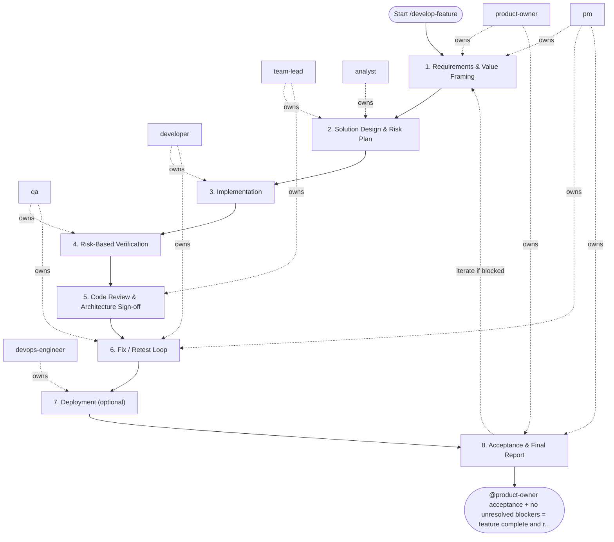

## Steps

### 1. Requirements & Value Framing — `@product-owner` + `@pm`
- **Input:** feature request from stakeholder or backlog
- **Actions:** define problem statement, expected outcomes, acceptance criteria, non-goals; confirm scope is implementation-ready
- **Output:** `docs/<feature>/README.md` with acceptance criteria
- **Done when:** criteria are testable and approved by `@product-owner`

### 2. Solution Design & Risk Plan — `@team-lead` + `@analyst`
- **Input:** approved acceptance criteria
- **Actions:** identify impacted domain entities and service boundaries; design API contracts and data model changes; define UX states and interaction constraints; flag security and performance risks; confirm approach with `@developer` for feasibility
- **Output:** `docs/<feature>/implementation_plan.md` — layers affected, risks, migration notes if any
- **Done when:** `@team-lead` and `@analyst` approve plan; no open architecture blockers

### 3. Implementation — `@developer`
- **Input:** approved implementation plan
- **Actions:**
  - implement changes layer by layer (inner to outer): models/schemas → repository → service → API
  - follow architecture rule: no business logic in API layer, no DB access in service layer directly
  - add or update unit tests alongside implementation
  - run `make lint && make test` locally before handoff
- **Output:** code changes on feature branch with passing local checks
- **Done when:** all acceptance criteria implemented; local checks green

### 4. Risk-Based Verification — `@qa`
- **Input:** feature branch + acceptance criteria
- **Actions:**
  - design test scenarios covering happy path, edge cases, failure paths
  - execute automated tests (unit + integration); run exploratory checks for acceptance criteria
  - verify security constraints (auth, input validation) per `security.md`
  - document findings with severity classification
- **Output:** `docs/<feature>/test_report.md` — pass/fail per scenario, defect list
- **Done when:** no critical or high-severity open defects

### 5. Code Review & Architecture Sign-off — `@team-lead`
- **Input:** feature branch + test report
- **Actions:** review layering and dependency rules; check test coverage quality; verify observability (logs, metrics, traces per `observability` skill); provide feedback as blocking / non-blocking
- **Output:** `review_feedback.md` or inline PR comments
- **Done when:** `@team-lead` approves; all blocking comments resolved

### 6. Fix / Retest Loop — `@developer` + `@qa` (coordinated by `@pm`)
- **Input:** blocking feedback list
- **Actions:** `@developer` fixes; `@qa` retests affected scenarios; maximum 3 fix/retest iterations — if still blocked after the third, stop and escalate to `@team-lead` with the open blocker list for a decision
- **Output:** updated code + updated test report
- **Done when:** zero open blocking issues

### 7. Deployment (optional) — `@devops-engineer`
- **Input:** QA go recommendation and the infrastructure, pipeline, configuration, or rollout changes the increment needs
- **Actions:** skip with a one-line note when no CI/CD, infrastructure, or deployment change is needed; otherwise apply changes through code (IaC / pipeline definitions), run the pipeline, and verify the rollback path
- **Output:** pipeline run evidence and `ops_notes.md` (or the documented skip)
- **Done when:** deployment evidence is attached, or the step is explicitly skipped as not needed

### 8. Acceptance & Final Report — `@product-owner` + `@pm`
- **Input:** verified increment + risk summary
- **Actions:** `@product-owner` validates acceptance criteria; `@pm` produces delivery summary with decisions and follow-ups; update feature docs under `docs/**`, add a `CHANGELOG.md` entry, and bump the project version
- **Output:** `docs/<feature>/delivery_summary.md` — accepted / deferred with rationale
- **Done when:** feature accepted or explicitly deferred; docs, `CHANGELOG.md`, and version bump committed

## Agent Interaction Diagram

<!-- agent-diagram:start -->

<!-- agent-diagram:end -->

## Iteration Loop
Steps 3–6 repeat per increment for large features (bounded by the increment list from step 2). `@pm` tracks scope changes and timeline impact.

## Role Delegation
- `lean` profile (default): the main session performs the role steps itself, in order, with the same outputs and gates. Use the `explorer` subagent before step 3 only when the code is unfamiliar, and the `reviewer` subagent once on the final diff.
- `team` profile: spawn one subagent per role: `@product-owner`, `@pm`, `@team-lead`, `@developer`, `@qa`, `@analyst`; add `@devops-engineer` only when step 7 is not skipped. One subagent never owns several roles.
- The two Post-task review specialists are additional read-only agents outside this SDLC matrix.
- Implementation starts only after the requirements outputs (steps 1) and design outputs (step 2) exist.
- Final delivery requires the verification evidence of step 5: the check commands and their output.

## Post-task review

- **Coordinator:** `@product-owner` (`execution.initiator`).
- **When:** after successful acceptance/sign-off and docs, CHANGELOG, and version completion, before the final user response.
- **Actions:** load `REVIEW_PIPELINE.md` from the project root; hand the same bounded evidence packet to `instruction-reviewer` and `memory-curator` as read-only specialists outside SDLC `roles`.
- **Once only:** review the top-level task once; nested workflows/increments hand observations to the parent. Do not launch inside fix/retest loops or after failed/deferred delivery.
- **Output:** `.reviews/<task-id>/instruction-review.md`, `memory-curation.md`, and `summary.md` (timestamp fallback per protocol); link them in the final response.
- **Lean profile:** skip this section when `instruction-reviewer` and `memory-curator` are not installed.
- **Failure:** record unavailable/failed specialists and evidence limitations; do not block successful delivery or retry automatically. Recommendations only; apply changes in a separate requested task.

## Exit
`@product-owner` acceptance + no unresolved blockers = feature complete and ready for release.

**Next:** terminal — no follow-up workflow.
