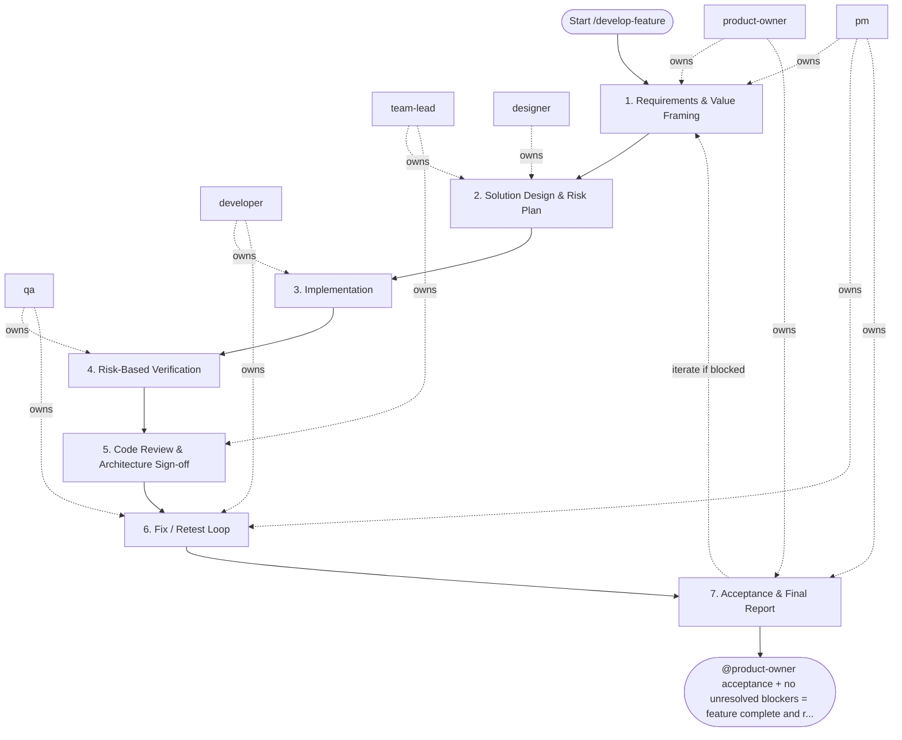

## Steps

### 1. Requirements & Value Framing — `@product-owner` + `@pm`
- **Input:** feature request from stakeholder or backlog
- **Actions:** define problem statement, expected outcomes, acceptance criteria, non-goals; confirm scope is implementation-ready
- **Output:** `docs/<feature>/README.md` with acceptance criteria
- **Done when:** criteria are testable and approved by `@product-owner`

### 2. Solution Design & Risk Plan — `@team-lead` + `@designer`
- **Input:** approved acceptance criteria
- **Actions:** identify impacted domain entities and service boundaries; design API contracts and data model changes; define UX states and interaction constraints; flag security and performance risks; confirm approach with `@developer` for feasibility
- **Output:** `docs/<feature>/implementation_plan.md` — layers affected, risks, migration notes if any
- **Done when:** `@team-lead` and `@designer` approve plan; no open architecture blockers

### 3. Implementation — `@developer`
- **Input:** approved implementation plan
- **Actions:**
  - implement changes layer by layer (inner to outer): models/schemas → repository → service → API
  - follow architecture rule: no business logic in API layer, no DB access in service layer directly
  - add or update unit tests alongside implementation
  - run `make lint && make test` locally before handoff
- **Output:** code changes on feature branch with passing local checks
- **Done when:** all acceptance criteria implemented; local checks green

### 4. Risk-Based Verification — `@qa`
- **Input:** feature branch + acceptance criteria
- **Actions:**
  - design test scenarios covering happy path, edge cases, failure paths
  - execute automated tests (unit + integration); run exploratory checks for acceptance criteria
  - verify security constraints (auth, input validation) per `security.md`
  - document findings with severity classification
- **Output:** `docs/<feature>/test_report.md` — pass/fail per scenario, defect list
- **Done when:** no critical or high-severity open defects

### 5. Code Review & Architecture Sign-off — `@team-lead`
- **Input:** feature branch + test report
- **Actions:** review layering and dependency rules; check test coverage quality; verify observability (logs, metrics, traces per `observability` skill); provide feedback as blocking / non-blocking
- **Output:** `review_feedback.md` or inline PR comments
- **Done when:** `@team-lead` approves; all blocking comments resolved

### 6. Fix / Retest Loop — `@developer` + `@qa` (coordinated by `@pm`)
- **Input:** blocking feedback list
- **Actions:** `@developer` fixes; `@qa` retests affected scenarios; maximum 3 fix/retest iterations — if still blocked after the third, stop and escalate to `@team-lead` with the open blocker list for a decision
- **Output:** updated code + updated test report
- **Done when:** zero open blocking issues

### 7. Acceptance & Final Report — `@product-owner` + `@pm`
- **Input:** verified increment + risk summary
- **Actions:** `@product-owner` validates acceptance criteria; `@pm` produces delivery summary with decisions and follow-ups; update feature docs under `docs/**`, add a `CHANGELOG.md` entry, and bump the project version
- **Output:** `docs/<feature>/delivery_summary.md` — accepted / deferred with rationale
- **Done when:** feature accepted or explicitly deferred; docs, `CHANGELOG.md`, and version bump committed

## Agent Interaction Diagram

<!-- agent-diagram:start -->

<!-- agent-diagram:end -->

## Iteration Loop
Steps 3–6 repeat per increment for large features (bounded by the increment list from step 2). `@pm` tracks scope changes and timeline impact.

## Mandatory Role Delegation
- For `/develop-feature`, the executor must spawn exactly 6 SDLC subagents, one per role: `@product-owner`, `@pm`, `@team-lead`, `@developer`, `@qa`, `@designer`.
- The two Post-task review specialists are additional read-only agents outside this six-agent SDLC matrix.
- Role consolidation is forbidden: one subagent cannot own multiple roles.
- Implementation work may start only after requirements outputs from `@product-owner` and `@pm`, and design outputs from `@team-lead` and `@designer`, are complete.
- Final delivery requires QA recommendation and team-lead sign-off.

## Optional JEV skill

Read `settings.jev.enabled` in project `.agentic.json`. When true, load
`.agent/skills/jev/SKILL.md` and use its helper at the checkpoints below.
When false/absent, skip this section and execute the standard workflow.
JEV is advisory; all required roles, QA, architecture sign-off and acceptance
remain mandatory. Missing/uncertain answers return to the assigned role. Copy
the question objects from the skill’s `references/questions.json` and follow
its `references/checkpoints.md` packet/action contracts; do not improvise
weaker questions. Keep original request and agreed scope in every packet.

| Checkpoint | State and maintained question | Handling |
| --- | --- | --- |
| Before approving a plan or extending scope | Original request, agreed scope/non-goals, approval provenance and proposed work. Use `scope_alignment` when scope alignment is disputed. | `scope_change` sends additions separately to PO/stakeholder; `clarify` gathers the missing decision. No silent maintenance or new resources. Normal plan approval remains mandatory. |
| Before the first spawn of each role, including exploration and specialists | Separate scoped role task and available model capabilities/cost order. Use `routing`: “Choose the least expensive sufficient model tier for this role's exact task within the original request and agreed scope.” | Apply a confident supported model override, preserving user pins/permissions. Record requested/observed model and fallback. Existing agents keep their model on followups; unsupported hosts retain their configured model. |
| Developer verification handoff | One claim, independent current command/run/tree identity, scenario/assertion and results. Use `evidence_support` for semantic coverage after local checks. | `supported` hands evidence to QA; `contradicted` returns a concrete finding; `insufficient` asks QA for the missing scenario/assertion. Failed/stale/missing command evidence needs no API call. JEV cannot authenticate execution. |
| Disputed review finding | Finding ID, cited criterion/gate, impact and diff evidence. Use `review_blocker`. | TL retains severity/sign-off ownership; optional unrelated maintenance becomes a separate proposal. Known failed gates already block without JEV. |
| After fixes, before another loop | Blocker IDs, current diff, independently verified closures, attempt history, limit and new hypothesis. Use `loop_action`. | `continue` gives Developer a bounded new hypothesis and QA retest; `gather_evidence` requests reproduction; `replan` requires PO/TL approval; `escalate` sends history to owners. `complete` requires all existing gates; exhausted limits escalate locally. |
| Before final acceptance | Exact criterion plus independent QA scenarios/assertions, expected/actual outputs and tree identity. Use `acceptance_support` per criterion. | PO owns acceptance. Contradictions return to QA/Developer; insufficient proof requests the missing scenario. Batch independent criteria; never weaken a criterion to match implemented behavior. |
| After the successful post-task specialist pair | Observed run history, current docs/instructions and concrete proposals with id/source/target/owner/done_when. Use `process_effectiveness`, `review_action` and independent `followup_needed` per proposal. | Report effectiveness separately from selected next-task IDs. Explicitly state no followup or missing evidence. Include target/owner/done_when for each recommendation; do not auto-edit guidance/memory. Cost efficiency uses `cost_effectiveness` only with measured total costs and a comparable accepted baseline; otherwise record insufficient locally. |

Invoke once for unchanged checkpoint evidence; batch related atomic questions.
Treat Choice/Score confidence below the skill's advisory floor as uncertain.
Never rerun merely to obtain a favorable verdict. No JEV request occurs when
its flag is disabled or there is no semantic decision beyond a deterministic check.

## Post-task review

- **Coordinator:** `@product-owner` (`execution.initiator`).
- **When:** after successful acceptance/sign-off and docs, CHANGELOG, and version completion, before the final user response.
- **Actions:** load `REVIEW_PIPELINE.md` from the project root; hand the same bounded evidence packet to `instruction_reviewer` and `memory_curator` as read-only specialists outside SDLC `roles`.
- **Once only:** review the top-level task once; nested workflows/increments hand observations to the parent. Do not launch inside fix/retest loops or after failed/deferred delivery.
- **Output:** `.reviews/<task-id>/instruction-review.md`, `memory-curation.md`, and `summary.md` (timestamp fallback per protocol); link them in the final response.
- **Failure:** record unavailable/failed specialists and evidence limitations; do not block successful delivery or retry automatically. Recommendations only; apply changes in a separate requested task.

## Exit
`@product-owner` acceptance + no unresolved blockers = feature complete and ready for release.

**Next:** terminal — no follow-up workflow.
