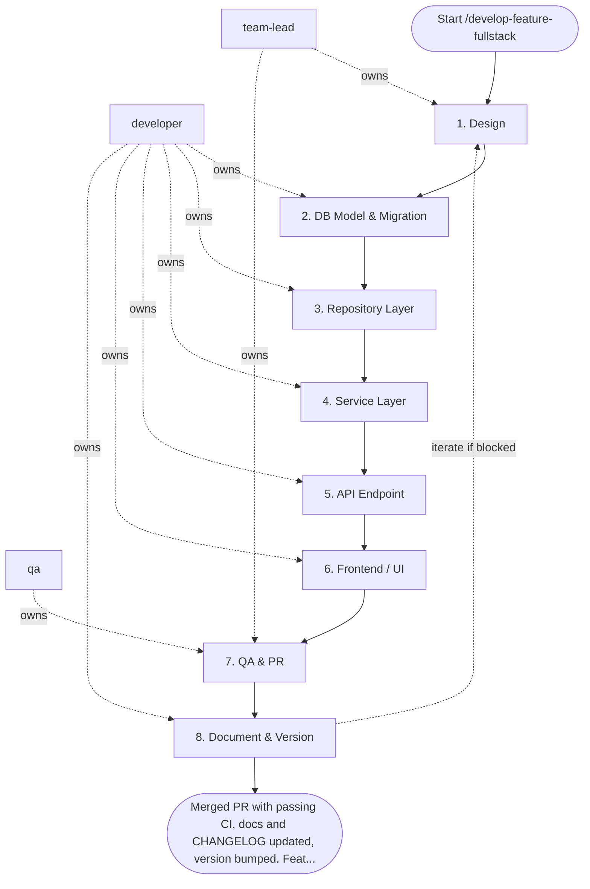

## Steps

### 1. Design — `@team-lead`
- **Input:** feature description, acceptance criteria
- **Actions:** clarify domain model changes; draft API contract (endpoint, request/response schema, error codes); identify DB schema changes needed; flag breaking changes
- **Output:** `docs/design/feature-<name>.md` — API contract + data model
- **Done when:** API contract approved — `@team-lead` sign-off recorded in the design doc

### 2. DB Model & Migration — `@developer`
- **Input:** `docs/design/feature-<name>.md`
- **Actions:** define/update SQLAlchemy models; generate Alembic migration (`alembic revision --autogenerate`); review migration file — check for unsafe operations (column rename, NOT NULL without default); run `alembic upgrade head`
- **Output:** migration file in `alembic/versions/`; updated `models/`
- **Done when:** `alembic upgrade head` succeeds; existing tests still pass

### 3. Repository Layer — `@developer`
- **Input:** updated models
- **Actions:** implement CRUD operations in `repositories/`; use `AsyncSession`; apply cursor-based pagination for list queries; write repository unit tests with transaction rollback isolation
- **Output:** `repositories/<entity>_repo.py` + tests
- **Done when:** repository tests pass; no business logic in repo layer

### 4. Service Layer — `@developer`
- **Input:** repository layer
- **Actions:** implement business logic in `services/`; enforce invariants; manage transactions (`async with session.begin()`); emit domain events if needed; write service unit tests with fake repository
- **Output:** `services/<entity>_service.py` + tests
- **Done when:** service tests pass; service imports only repository, not DB directly

### 5. API Endpoint — `@developer`
- **Input:** service layer, API contract from Step 1
- **Actions:** implement FastAPI endpoint in `api/v1/endpoints/`; validate inputs via Pydantic schemas; use FastAPI `Depends()` for auth + DB; apply correct HTTP status codes; write API integration tests
- **Output:** endpoint file + `schemas/<entity>.py` + integration tests
- **Done when:** endpoint matches contract from Step 1; auth + validation tested; `make lint` clean

### 6. Frontend / UI — `@developer`
- **Input:** API contract, acceptance criteria
- **Actions:** implement UI changes (component, page, server action); connect to API; handle loading/error/empty states; add `data-testid` for E2E selectors
- **Output:** updated `features/<name>/` directory
- **Done when:** feature visible and functional in dev; all states handled

### 7. QA & PR — `@qa` + `@team-lead`
- **Input:** complete implementation from steps 2–6 (feature branch)
- **Actions:** write/run E2E test covering acceptance criteria; run full test suite (`make test`); verify no ruff/mypy errors; create PR with: description, test evidence (output), design doc link
- **Output:** passing CI + PR ready for review
- **Done when:** `make test` green; `make lint` clean; PR submitted

### 8. Document & Version — `@developer`
- **Input:** merged PR from step 7
- **Actions:** update feature docs under `docs/<feature>/README.md`; add a user-facing entry to `CHANGELOG.md`; bump the project version in the version source
- **Output:** docs + CHANGELOG + version committed in the same change set
- **Done when:** docs, CHANGELOG, and version merged

## Agent Interaction Diagram

<!-- agent-diagram:start -->

<!-- agent-diagram:end -->

## Iteration Loop
If review finds issues → return to relevant step (Step 2 for schema issues, Step 4 for logic issues, Step 5 for API issues). Maximum 3 return iterations; if issues remain open after the third, stop and escalate to `@team-lead` with the open blocker list for a scope or design decision.

## Optional JEV skill

Read `settings.jev.enabled` in project `.agentic.json`. When true, load
`.agent/skills/jev/SKILL.md` and use its helper at the checkpoints below.
When false/absent, skip this section and execute the standard workflow.
JEV is advisory; all required roles, QA, architecture sign-off and acceptance
remain mandatory. Missing/uncertain answers return to the assigned role. Copy
the question objects from the skill’s `references/questions.json` and follow
its `references/checkpoints.md` packet/action contracts; do not improvise
weaker questions. Keep original request and agreed scope in every packet.

| Checkpoint | State and maintained question | Handling |
| --- | --- | --- |
| Before approving a plan or extending scope | Original request, agreed scope/non-goals, approval provenance and proposed work. Use `scope_alignment` when scope alignment is disputed. | `scope_change` sends additions separately to PO/stakeholder; `clarify` gathers the missing decision. No silent maintenance or new resources. Normal plan approval remains mandatory. |
| Before the first spawn of each role, including exploration and specialists | Separate scoped role task and available model capabilities/cost order. Use `routing`: “Choose the least expensive sufficient model tier for this role's exact task within the original request and agreed scope.” | Apply a confident supported model override, preserving user pins/permissions. Record requested/observed model and fallback. Existing agents keep their model on followups; unsupported hosts retain their configured model. |
| Developer verification handoff | One claim, independent current command/run/tree identity, scenario/assertion and results. Use `evidence_support` for semantic coverage after local checks. | `supported` hands evidence to QA; `contradicted` returns a concrete finding; `insufficient` asks QA for the missing scenario/assertion. Failed/stale/missing command evidence needs no API call. JEV cannot authenticate execution. |
| Disputed review finding | Finding ID, cited criterion/gate, impact and diff evidence. Use `review_blocker`. | TL retains severity/sign-off ownership; optional unrelated maintenance becomes a separate proposal. Known failed gates already block without JEV. |
| After fixes, before another loop | Blocker IDs, current diff, independently verified closures, attempt history, limit and new hypothesis. Use `loop_action`. | `continue` gives Developer a bounded new hypothesis and QA retest; `gather_evidence` requests reproduction; `replan` requires PO/TL approval; `escalate` sends history to owners. `complete` requires all existing gates; exhausted limits escalate locally. |
| Before final acceptance | Exact criterion plus independent QA scenarios/assertions, expected/actual outputs and tree identity. Use `acceptance_support` per criterion. | PO owns acceptance. Contradictions return to QA/Developer; insufficient proof requests the missing scenario. Batch independent criteria; never weaken a criterion to match implemented behavior. |
| After the successful post-task specialist pair | Observed run history, current docs/instructions and concrete proposals with id/source/target/owner/done_when. Use `process_effectiveness`, `review_action` and independent `followup_needed` per proposal. | Report effectiveness separately from selected next-task IDs. Explicitly state no followup or missing evidence. Include target/owner/done_when for each recommendation; do not auto-edit guidance/memory. Cost efficiency uses `cost_effectiveness` only with measured total costs and a comparable accepted baseline; otherwise record insufficient locally. |

Invoke once for unchanged checkpoint evidence; batch related atomic questions.
Treat Choice/Score confidence below the skill's advisory floor as uncertain.
Never rerun merely to obtain a favorable verdict. No JEV request occurs when
its flag is disabled or there is no semantic decision beyond a deterministic check.

## Post-task review

- **Coordinator:** `@team-lead` (`execution.initiator`).
- **When:** after successful acceptance/sign-off and docs, CHANGELOG, and version completion, before the final user response.
- **Actions:** load `REVIEW_PIPELINE.md` from the project root; hand the same bounded evidence packet to `instruction_reviewer` and `memory_curator` as read-only specialists outside SDLC `roles`.
- **Once only:** review the top-level task once; nested workflows/increments hand observations to the parent. Do not launch inside fix/retest loops or after failed/deferred delivery.
- **Output:** `.reviews/<task-id>/instruction-review.md`, `memory-curation.md`, and `summary.md` (timestamp fallback per protocol); link them in the final response.
- **Failure:** record unavailable/failed specialists and evidence limitations; do not block successful delivery or retry automatically. Recommendations only; apply changes in a separate requested task.

## Exit
Merged PR with passing CI, docs and CHANGELOG updated, version bumped. Feature accessible in target environment.

**Next:** terminal — no follow-up workflow.
