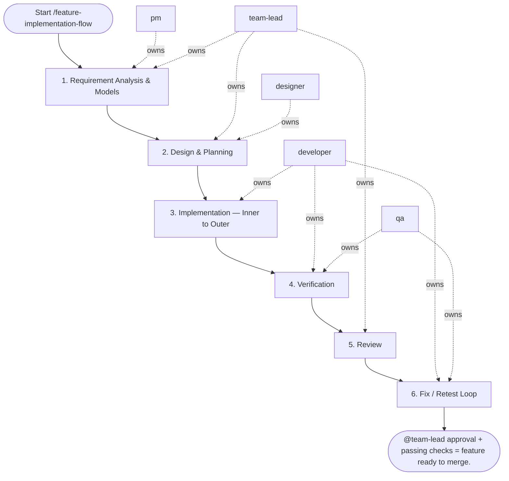

## Steps

### 1. Requirement Analysis & Models — `@pm` + `@team-lead`
- **Input:** feature request
- **Actions:** `@pm` captures requirements; `@team-lead` identifies impacted domain entities and determines if schema changes are needed; if UI is involved, `@designer` delivers the UI spec/mockup artifact (`docs/<feature>/ui_spec.md` or linked mockup)
- **Output:** confirmed feature spec with data model notes (+ `@designer` UI spec/mockup when UI is involved)
- **Done when:** impacted layers identified; `@developer` briefed

### 2. Design & Planning — `@team-lead` + `@designer`
- **Input:** confirmed feature spec
- **Actions:** design layer changes (models → repository → service → API); specify Pydantic/DTO schemas for input/output; plan Alembic migration if schema changes needed; define UX states (loading / empty / error / success) if frontend involved
- **Output:** brief implementation plan presented to `@pm` for user confirmation
- **Done when:** user/stakeholder confirms plan; approach is approved

### 3. Implementation — Inner to Outer — `@developer`
- **Input:** approved implementation plan
- **Actions:**
  - **Models/Schemas:** update `src/models/` (SQLAlchemy) if schema changes; create Alembic migration; define Pydantic input/output schemas in `src/schemas/`
  - **Repository Layer:** implement data access methods in `src/repositories/`; ensure IO-bound operations are async
  - **Service Layer:** implement business logic in `src/services/`; inject repository dependencies; handle exceptions, convert to business errors; do not import FastAPI/Flask objects here
  - **API Layer:** add/update endpoints in `src/api/`; validate input via schemas; call service methods only; no direct DB access
- **Output:** feature implemented on branch; no cross-layer violations
- **Done when:** all layers implemented; local checks pass

### 4. Verification — `@developer` + `@qa`
- **Input:** implemented feature branch
- **Actions:**
  - unit tests: test service logic (mock repositories); test repository logic (test DB or mocks)
  - integration tests: test API endpoints end-to-end with test client
  - `make lint` — zero errors; `make fmt` — no diffs; strict typing verified
  - `@qa` runs acceptance checks against feature spec
- **Output:** passing test suite; lint/type checks clean
- **Done when:** all checks pass; acceptance criteria verified

### 5. Review — `@team-lead`
- **Input:** feature branch + test results
- **Actions:** verify layer boundaries respected; check schema definitions and error handling; review test quality; provide blocking / non-blocking feedback
- **Output:** review feedback
- **Done when:** all blocking feedback resolved; `@team-lead` approves

### 6. Fix / Retest Loop — `@developer` + `@qa`
- **Input:** blocking feedback
- **Actions:** fix; re-run checks; re-request review; maximum 3 fix/retest cycles — if still blocked after the third, stop and escalate to `@team-lead` with the open blocker list for a decision; once approved, update feature docs under `docs/**`, add a `CHANGELOG.md` entry, and bump the project version
- **Output:** green test run + review-ready branch
- **Done when:** zero blocking issues; all checks green; docs, `CHANGELOG.md`, and version bump committed

## Optional JEV skill

Read `settings.jev.enabled` in project `.agentic.json`. When true, load
`.agent/skills/jev/SKILL.md` and use its helper at the checkpoints below.
When false/absent, skip this section and execute the standard workflow.
JEV is advisory; all required roles, QA, architecture sign-off and acceptance
remain mandatory. Missing/uncertain answers return to the assigned role. Copy
the question objects from the skill’s `references/questions.json` and follow
its `references/checkpoints.md` packet/action contracts; do not improvise
weaker questions. Keep original request and agreed scope in every packet.

| Checkpoint | State and maintained question | Handling |
| --- | --- | --- |
| Before approving a plan or extending scope | Original request, agreed scope/non-goals, approval provenance and proposed work. Use `scope_alignment` when scope alignment is disputed. | `scope_change` sends additions separately to PO/stakeholder; `clarify` gathers the missing decision. No silent maintenance or new resources. Normal plan approval remains mandatory. |
| Before the first spawn of each role, including exploration and specialists | Separate scoped role task and available model capabilities/cost order. Use `routing`: “Choose the least expensive sufficient model tier for this role's exact task within the original request and agreed scope.” | Apply a confident supported model override, preserving user pins/permissions. Record requested/observed model and fallback. Existing agents keep their model on followups; unsupported hosts retain their configured model. |
| Developer verification handoff | One claim, independent current command/run/tree identity, scenario/assertion and results. Use `evidence_support` for semantic coverage after local checks. | `supported` hands evidence to QA; `contradicted` returns a concrete finding; `insufficient` asks QA for the missing scenario/assertion. Failed/stale/missing command evidence needs no API call. JEV cannot authenticate execution. |
| Disputed review finding | Finding ID, cited criterion/gate, impact and diff evidence. Use `review_blocker`. | TL retains severity/sign-off ownership; optional unrelated maintenance becomes a separate proposal. Known failed gates already block without JEV. |
| After fixes, before another loop | Blocker IDs, current diff, independently verified closures, attempt history, limit and new hypothesis. Use `loop_action`. | `continue` gives Developer a bounded new hypothesis and QA retest; `gather_evidence` requests reproduction; `replan` requires PO/TL approval; `escalate` sends history to owners. `complete` requires all existing gates; exhausted limits escalate locally. |
| Before final acceptance | Exact criterion plus independent QA scenarios/assertions, expected/actual outputs and tree identity. Use `acceptance_support` per criterion. | PO owns acceptance. Contradictions return to QA/Developer; insufficient proof requests the missing scenario. Batch independent criteria; never weaken a criterion to match implemented behavior. |
| After the successful post-task specialist pair | Observed run history, current docs/instructions and concrete proposals with id/source/target/owner/done_when. Use `process_effectiveness`, `review_action` and independent `followup_needed` per proposal. | Report effectiveness separately from selected next-task IDs. Explicitly state no followup or missing evidence. Include target/owner/done_when for each recommendation; do not auto-edit guidance/memory. Cost efficiency uses `cost_effectiveness` only with measured total costs and a comparable accepted baseline; otherwise record insufficient locally. |

Invoke once for unchanged checkpoint evidence; batch related atomic questions.
Treat Choice/Score confidence below the skill's advisory floor as uncertain.
Never rerun merely to obtain a favorable verdict. No JEV request occurs when
its flag is disabled or there is no semantic decision beyond a deterministic check.

## Post-task review

- **Coordinator:** `@pm` (`execution.initiator`).
- **When:** after successful acceptance/sign-off and docs, CHANGELOG, and version completion, before the final user response.
- **Actions:** load `REVIEW_PIPELINE.md` from the project root; hand the same bounded evidence packet to `instruction_reviewer` and `memory_curator` as read-only specialists outside SDLC `roles`.
- **Once only:** review the top-level task once; nested workflows/increments hand observations to the parent. Do not launch inside fix/retest loops or after failed/deferred delivery.
- **Output:** `.reviews/<task-id>/instruction-review.md`, `memory-curation.md`, and `summary.md` (timestamp fallback per protocol); link them in the final response.
- **Failure:** record unavailable/failed specialists and evidence limitations; do not block successful delivery or retry automatically. Recommendations only; apply changes in a separate requested task.

## Agent Interaction Diagram

<!-- agent-diagram:start -->

<!-- agent-diagram:end -->

## Exit
`@team-lead` approval + passing checks = feature ready to merge.

**Next:** terminal — no follow-up workflow.
