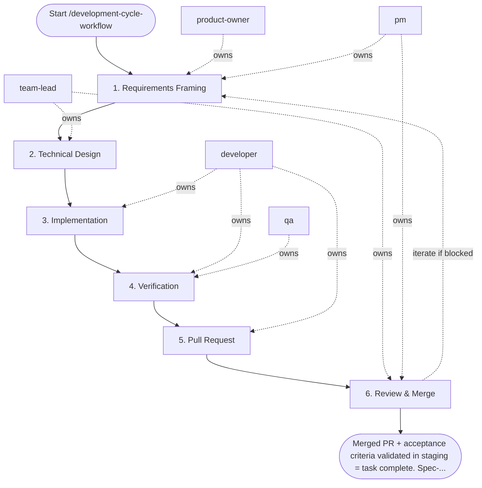

## Steps

### 1. Requirements Framing — `@product-owner` + `@pm`
- **Input:** task or issue description
- **Actions:** define acceptance criteria; clarify scope and non-goals; if larger than 1 day of work — break into sub-tasks
- **Output:** confirmed acceptance criteria added to the ticket
- **Done when:** criteria are testable and agreed upon

### 2. Technical Design — `@team-lead`
- **Input:** confirmed acceptance criteria
- **Actions:** identify impacted code areas; flag architectural risks; approve approach or request changes
- **Output:** brief design note (inline comment or `docs/<task>/notes.md` for significant changes)
- **Done when:** implementation approach is unambiguous

### 3. Implementation — `@developer`
- **Input:** confirmed acceptance criteria + design note
- **Actions:**
  - pull latest `main`, create branch: `git checkout -b feature/<task-id>-short-desc`
  - implement in small logical commits; follow code style rules
  - run `make fmt` after each logical change
  - do not mix unrelated changes in the same branch
- **Output:** code changes on feature branch
- **Done when:** implementation covers all acceptance criteria

### 4. Verification — `@developer` → `@qa`
- **Input:** feature branch with green local tests from step 3 (handed from `@developer` to `@qa`)
- **Actions:**
  - `make test` — all tests pass
  - `make lint` — zero errors
  - `make fmt` — no diffs
  - add or update tests for any new behavior
  - `@qa` runs exploratory checks against acceptance criteria
- **Output:** green local checks; test evidence attached to PR
- **Done when:** no failing checks; acceptance criteria manually verified

### 5. Pull Request — `@developer`
- **Input:** green checks, test evidence
- **Actions:** open PR with title `[TASK-ID] Short description`; body includes what changed, why, how to test, screenshots if UI; assign reviewer; CI must pass before review
- **Output:** open PR with passing CI
- **Done when:** PR is open and CI is green

### 6. Review & Merge — `@team-lead` (coordinated by `@pm`)
- **Input:** open PR
- **Actions:** `@team-lead` reviews code quality, architecture, and tests; `@developer` addresses all blocking comments; squash or rebase per project convention; merge; delete feature branch; update docs under `docs/**`, add a `CHANGELOG.md` entry, and bump the project version (root completion contract)
- **Output:** merged PR; feature branch deleted
- **Done when:** PR is merged and change is verified in staging/preview; docs, `CHANGELOG.md`, and version bump committed

## Agent Interaction Diagram

<!-- agent-diagram:start -->

<!-- agent-diagram:end -->

## Iteration Loop
If verification (Step 4) or review (Step 6) reveals gaps → return to Step 3. Maximum 3 returns; if still blocked after the third, stop and escalate to `@team-lead` with the open blocker list for a decision. `@pm` tracks blockers and timeline.

## Optional JEV skill

Read `settings.jev.enabled` in project `.agentic.json`. When true, load
`.agent/skills/jev/SKILL.md` and use its helper at the checkpoints below.
When false/absent, skip this section and execute the standard workflow.
JEV is advisory; all required roles, QA, architecture sign-off and acceptance
remain mandatory. Missing/uncertain answers return to the assigned role. Copy
the question objects from the skill’s `references/questions.json` and follow
its `references/checkpoints.md` packet/action contracts; do not improvise
weaker questions. Keep original request and agreed scope in every packet.

| Checkpoint | State and maintained question | Handling |
| --- | --- | --- |
| Before approving a plan or extending scope | Original request, agreed scope/non-goals, approval provenance and proposed work. Use `scope_alignment` when scope alignment is disputed. | `scope_change` sends additions separately to PO/stakeholder; `clarify` gathers the missing decision. No silent maintenance or new resources. Normal plan approval remains mandatory. |
| Before the first spawn of each role, including exploration and specialists | Separate scoped role task and available model capabilities/cost order. Use `routing`: “Choose the least expensive sufficient model tier for this role's exact task within the original request and agreed scope.” | Apply a confident supported model override, preserving user pins/permissions. Record requested/observed model and fallback. Existing agents keep their model on followups; unsupported hosts retain their configured model. |
| Developer verification handoff | One claim, independent current command/run/tree identity, scenario/assertion and results. Use `evidence_support` for semantic coverage after local checks. | `supported` hands evidence to QA; `contradicted` returns a concrete finding; `insufficient` asks QA for the missing scenario/assertion. Failed/stale/missing command evidence needs no API call. JEV cannot authenticate execution. |
| Disputed review finding | Finding ID, cited criterion/gate, impact and diff evidence. Use `review_blocker`. | TL retains severity/sign-off ownership; optional unrelated maintenance becomes a separate proposal. Known failed gates already block without JEV. |
| After fixes, before another loop | Blocker IDs, current diff, independently verified closures, attempt history, limit and new hypothesis. Use `loop_action`. | `continue` gives Developer a bounded new hypothesis and QA retest; `gather_evidence` requests reproduction; `replan` requires PO/TL approval; `escalate` sends history to owners. `complete` requires all existing gates; exhausted limits escalate locally. |
| Before final acceptance | Exact criterion plus independent QA scenarios/assertions, expected/actual outputs and tree identity. Use `acceptance_support` per criterion. | PO owns acceptance. Contradictions return to QA/Developer; insufficient proof requests the missing scenario. Batch independent criteria; never weaken a criterion to match implemented behavior. |
| After the successful post-task specialist pair | Observed run history, current docs/instructions and concrete proposals with id/source/target/owner/done_when. Use `process_effectiveness`, `review_action` and independent `followup_needed` per proposal. | Report effectiveness separately from selected next-task IDs. Explicitly state no followup or missing evidence. Include target/owner/done_when for each recommendation; do not auto-edit guidance/memory. Cost efficiency uses `cost_effectiveness` only with measured total costs and a comparable accepted baseline; otherwise record insufficient locally. |

Invoke once for unchanged checkpoint evidence; batch related atomic questions.
Treat Choice/Score confidence below the skill's advisory floor as uncertain.
Never rerun merely to obtain a favorable verdict. No JEV request occurs when
its flag is disabled or there is no semantic decision beyond a deterministic check.

## Post-task review

- **Coordinator:** `@product-owner` (`execution.initiator`).
- **When:** after successful acceptance/sign-off and docs, CHANGELOG, and version completion, before the final user response.
- **Actions:** load `REVIEW_PIPELINE.md` from the project root; hand the same bounded evidence packet to `instruction_reviewer` and `memory_curator` as read-only specialists outside SDLC `roles`.
- **Once only:** review the top-level task once; nested workflows/increments hand observations to the parent. Do not launch inside fix/retest loops or after failed/deferred delivery.
- **Output:** `.reviews/<task-id>/instruction-review.md`, `memory-curation.md`, and `summary.md` (timestamp fallback per protocol); link them in the final response.
- **Failure:** record unavailable/failed specialists and evidence limitations; do not block successful delivery or retry automatically. Recommendations only; apply changes in a separate requested task.

## Exit
Merged PR + acceptance criteria validated in staging = task complete. Spec-specific delivery workflows take precedence over this generic cycle when one exists for the domain.

**Next:** terminal — no follow-up workflow.
