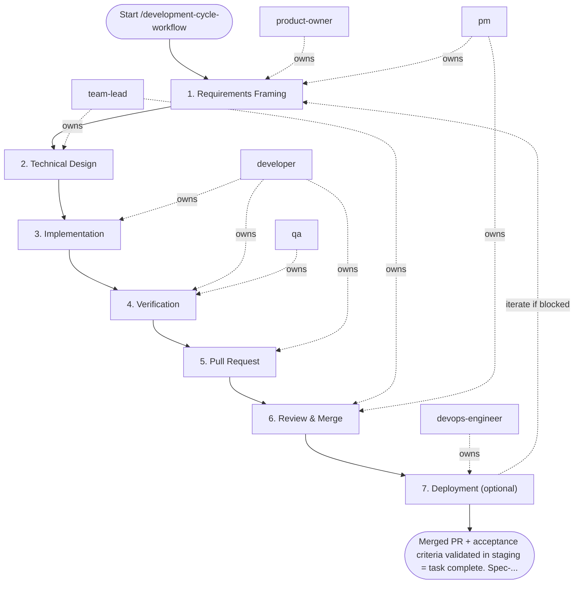

## Steps

### 1. Requirements Framing — `@product-owner` + `@pm`
- **Input:** task or issue description
- **Actions:** define acceptance criteria; clarify scope and non-goals; if larger than 1 day of work — break into sub-tasks
- **Output:** confirmed acceptance criteria added to the ticket
- **Done when:** criteria are testable and agreed upon

### 2. Technical Design — `@team-lead`
- **Input:** confirmed acceptance criteria
- **Actions:** identify impacted code areas; flag architectural risks; approve approach or request changes
- **Output:** brief design note (inline comment or `docs/<task>/notes.md` for significant changes)
- **Done when:** implementation approach is unambiguous

### 3. Implementation — `@developer`
- **Input:** confirmed acceptance criteria + design note
- **Actions:**
  - pull latest `main`, create branch: `git checkout -b feature/<task-id>-short-desc`
  - implement in small logical commits; follow code style rules
  - run `make fmt` after each logical change
  - do not mix unrelated changes in the same branch
- **Output:** code changes on feature branch
- **Done when:** implementation covers all acceptance criteria

### 4. Verification — `@developer` → `@qa`
- **Input:** feature branch with green local tests from step 3 (handed from `@developer` to `@qa`)
- **Actions:**
  - `make test` — all tests pass
  - `make lint` — zero errors
  - `make fmt` — no diffs
  - add or update tests for any new behavior
  - `@qa` runs exploratory checks against acceptance criteria
- **Output:** green local checks; test evidence attached to PR
- **Done when:** no failing checks; acceptance criteria manually verified

### 5. Pull Request — `@developer`
- **Input:** green checks, test evidence
- **Actions:** open PR with title `[TASK-ID] Short description`; body includes what changed, why, how to test, screenshots if UI; assign reviewer; CI must pass before review
- **Output:** open PR with passing CI
- **Done when:** PR is open and CI is green

### 6. Review & Merge — `@team-lead` (coordinated by `@pm`)
- **Input:** open PR
- **Actions:** `@team-lead` reviews code quality, architecture, and tests; `@developer` addresses all blocking comments; squash or rebase per project convention; merge; delete feature branch; update docs under `docs/**` (and `README.md` per `.agent/rules/readme-sync-guide.md` when setup or usage changed), add a `CHANGELOG.md` entry, and bump the project version only for a completed feature; a bugfix updates `CHANGELOG.md` only (root completion contract)
- **Output:** merged PR; feature branch deleted
- **Done when:** PR is merged and change is verified in staging/preview; docs, `CHANGELOG.md`, and (for a feature) version bump committed

### 7. Deployment (optional) — `@devops-engineer`
- **Input:** QA go recommendation and the infrastructure, pipeline, configuration, or rollout changes the increment needs
- **Actions:** skip with a one-line note when no CI/CD, infrastructure, or deployment change is needed; otherwise apply changes through code (IaC / pipeline definitions), run the pipeline, and verify the rollback path
- **Output:** pipeline run evidence and `ops_notes.md` (or the documented skip)
- **Done when:** deployment evidence is attached, or the step is explicitly skipped as not needed

## Agent Interaction Diagram

<!-- agent-diagram:start -->

<!-- agent-diagram:end -->

## Iteration Loop
If verification (Step 4) or review (Step 6) reveals gaps → return to Step 3. Maximum 3 returns; if still blocked after the third, stop and escalate to `@team-lead` with the open blocker list for a decision. `@pm` tracks blockers and timeline.

## Post-task review

- **Coordinator:** `@product-owner` (`execution.initiator`).
- **When:** after successful acceptance/sign-off and docs, CHANGELOG, and version completion, before the final user response.
- **Actions:** load `REVIEW_PIPELINE.md` from the project root; hand the same bounded evidence packet to `instruction-reviewer` and `memory-curator` as read-only specialists outside SDLC `roles`.
- **Once only:** review the top-level task once; nested workflows/increments hand observations to the parent. Do not launch inside fix/retest loops or after failed/deferred delivery.
- **Output:** `.reviews/<task-id>/instruction-review.md`, `memory-curation.md`, and `summary.md` (timestamp fallback per protocol); link them in the final response.
- **Lean profile:** skip this section when `instruction-reviewer` and `memory-curator` are not installed.
- **Failure:** record unavailable/failed specialists and evidence limitations; do not block successful delivery or retry automatically. Recommendations only; apply changes in a separate requested task.

## Exit
Merged PR + acceptance criteria validated in staging = task complete. Spec-specific delivery workflows take precedence over this generic cycle when one exists for the domain.

**Next:** terminal — no follow-up workflow.
